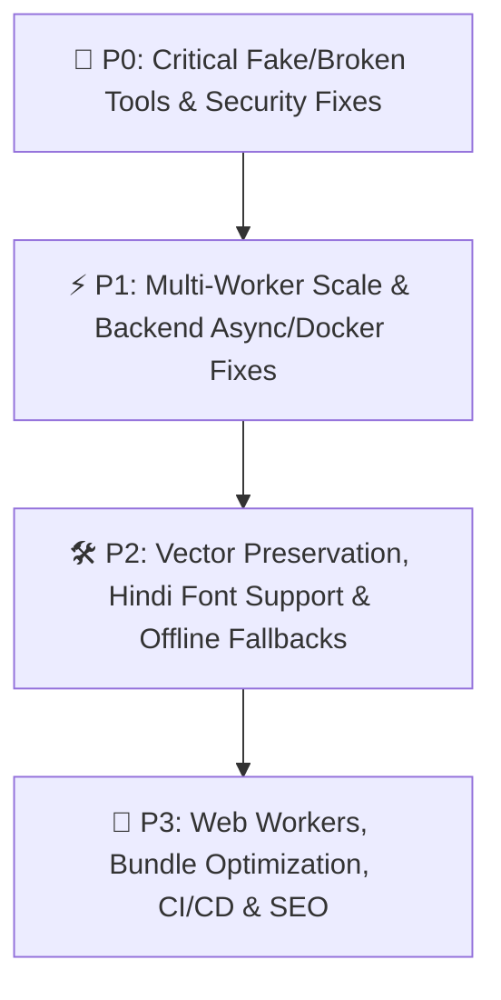

# 🔍 PDF Media Suite — Complete Enterprise & Codebase Audit Report

**Scope Audited (100% of Repository — Saved Across 8 Modular Audit Parts):**
- **Part 1 (Backend A):** [`part_1_backend_a.md`](file:///Users/pankajmeena/.gemini/antigravity/brain/35dc76f2-c551-4f17-968e-1fdcdda9c7f8/audit_parts/part_1_backend_a.md) — [`backend/main.py`](file:///Users/pankajmeena/pdf%20tool/pdf-tool/backend/main.py#L1-L2553) (Lines 1–2553), [`render.yaml`](file:///Users/pankajmeena/pdf%20tool/pdf-tool/render.yaml), [`backend/Dockerfile`](file:///Users/pankajmeena/pdf%20tool/pdf-tool/backend/Dockerfile), [`backend/requirements.txt`](file:///Users/pankajmeena/pdf%20tool/pdf-tool/backend/requirements.txt), `.env` security check
- **Part 2 (Backend B):** [`part_2_backend_b.md`](file:///Users/pankajmeena/.gemini/antigravity/brain/35dc76f2-c551-4f17-968e-1fdcdda9c7f8/audit_parts/part_2_backend_b.md) — [`backend/main.py`](file:///Users/pankajmeena/pdf%20tool/pdf-tool/backend/main.py#L2400-L4725) (Lines 2400–4725), [`backend/telemetry.py`](file:///Users/pankajmeena/pdf%20tool/pdf-tool/backend/telemetry.py#L1-L467), `/api/print-drop/*`, `/admin`
- **Part 3 (Pages A–C, 31 Pages):** [`part_3_pages_a_c.md`](file:///Users/pankajmeena/.gemini/antigravity/brain/35dc76f2-c551-4f17-968e-1fdcdda9c7f8/audit_parts/part_3_pages_a_c.md) — `About.tsx` through `CryptographicSignatures.tsx`
- **Part 4 (Pages D–I, 37 Pages):** [`part_4_pages_d_i.md`](file:///Users/pankajmeena/.gemini/antigravity/brain/35dc76f2-c551-4f17-968e-1fdcdda9c7f8/audit_parts/part_4_pages_d_i.md) — `DeskewPDF.tsx` through `InvertColorsPDF.tsx`
- **Part 5 (Pages J–P, 41 Pages):** [`part_5_pages_j_p.md`](file:///Users/pankajmeena/.gemini/antigravity/brain/35dc76f2-c551-4f17-968e-1fdcdda9c7f8/audit_parts/part_5_pages_j_p.md) — `JPGToPDF.tsx` through `PvcCardMaker.tsx`
- **Part 6 (Pages Q–S, 29 Pages):** [`part_6_pages_q_s.md`](file:///Users/pankajmeena/.gemini/antigravity/brain/35dc76f2-c551-4f17-968e-1fdcdda9c7f8/audit_parts/part_6_pages_q_s.md) — `QrCodeGenerator.tsx` through `StampPaperAligner.tsx`
- **Part 7 (Pages T–Z, 13 Pages + Modal):** [`part_7_pages_t_z.md`](file:///Users/pankajmeena/.gemini/antigravity/brain/35dc76f2-c551-4f17-968e-1fdcdda9c7f8/audit_parts/part_7_pages_t_z.md) — `TalkingNotes.tsx` through `ZeroTracePrint.tsx` + `AdminDashboard.tsx` + `ShareQrModal.tsx`
- **Part 8 (Shared Infra & Extension):** [`part_8_shared_infra.md`](file:///Users/pankajmeena/.gemini/antigravity/brain/35dc76f2-c551-4f17-968e-1fdcdda9c7f8/audit_parts/part_8_shared_infra.md) — `src/lib/*`, `src/components/*`, `extension/*`, `index.html`, `vite.config.ts`, `package.json`, `public/sw.js`, SEO/Sitemap

---

## 🔴 SECTION 1: Dummy, Fake & Cosmetic Features (Jo Naam Se Real Lagte Hain Par Andar Se Fake/Broken Hain)

> [!CAUTION]
> Neeche diye gaye **21 features/components** ya to sirf dikhawe (cosmetic) ka kaam karte hain, ya user ko galat security/output dikhate hain. Enterprise ya production par inhe bina theek kiye rakhna legal aur user-trust ke liye sabse bada risk hai.

### 1. [`ShareQrModal.tsx`](file:///Users/pankajmeena/pdf%20tool/pdf-tool/src/components/ShareQrModal.tsx#L30-L83) — 100% Fake `Math.sin()` QR Code (Used Across 5 Tools!)
- **Kahan use hota hai:** [`XeroxCleaner.tsx`](file:///Users/pankajmeena/pdf%20tool/pdf-tool/src/pages/XeroxCleaner.tsx#L531-L536), [`RubberStampMaker.tsx`](file:///Users/pankajmeena/pdf%20tool/pdf-tool/src/pages/RubberStampMaker.tsx#L615-L620), [`SelfAttest.tsx`](file:///Users/pankajmeena/pdf%20tool/pdf-tool/src/pages/SelfAttest.tsx#L753-L758), [`SlideHandouts.tsx`](file:///Users/pankajmeena/pdf%20tool/pdf-tool/src/pages/SlideHandouts.tsx#L534-L539), [`StampPaperAligner.tsx`](file:///Users/pankajmeena/pdf%20tool/pdf-tool/src/pages/StampPaperAligner.tsx#L561-L566).
- **Kya Fake Hai:** Jab user **"Send to Phone (WhatsApp / QR)"** par click karta hai, to [`ShareQrModal.tsx#L75-L79`](file:///Users/pankajmeena/pdf%20tool/pdf-tool/src/components/ShareQrModal.tsx#L75-L79) me koi real QR code generate nahi hota! Wahan `Math.sin(x * 12.9898 + y * 78.233 + hash) * 43758.5453` se random black-and-white boxes draw kiye gaye hain jo duniya ke kisi scanner se scan nahi ho sakte. Aur WhatsApp button bhi generated PDF nahi bhejta, sirf `window.location.href` (website link) bhejta hai.
- **Upgrade Fix:** `qrcode` library (jo already `package.json` me installed hai) se real QR generate karein ya `navigator.share({ files: [pdfFile] })` + `/api/print-drop` temporary cloud link se real PDF transfer karein.

### 2. [`TalkingNotes.tsx`](file:///Users/pankajmeena/pdf%20tool/pdf-tool/src/pages/TalkingNotes.tsx#L123-L287) — Audio Record Karta Hai Par PDF Export Me Audio Fek Deta Hai!
- **Kya Fake Hai:** Browser me microphone se real audio record hoti hai (`anno.audioBlob`), lekin [`handleExportPdf` (`L192-L287`)](file:///Users/pankajmeena/pdf%20tool/pdf-tool/src/pages/TalkingNotes.tsx#L192-L287) us recorded `audioBlob` ko **kabhi read ya upload hi nahi karta**! Wo seedha ek hardcoded fake URL (`https://pdfmediasuite.in/audio-note?id=...`, [`L208`](file:///Users/pankajmeena/pdf%20tool/pdf-tool/src/pages/TalkingNotes.tsx#L208)) ka QR code PDF par chipka deta hai. `/audio-note` naam ka koi route [`App.tsx`](file:///Users/pankajmeena/pdf%20tool/pdf-tool/src/App.tsx) me hai hi nahi (404 NotFound aata hai).
- **Upgrade Fix:** Audio blob ko backend/R2 storage par upload karke real `/audio-note/:id` player page banayein, aur PDF ke andar `pdfDoc.attach()` se audio file embed bhi karein.

### 3. [`PdfSanitizer.tsx`](file:///Users/pankajmeena/pdf%20tool/pdf-tool/src/pages/PdfSanitizer.tsx#L73-L154) — 8 Me Se 7 Sanitization Steps 100% Fake / No-Op Hain!
- **Kya Fake/Broken Hai:**
  1. Steps 2, 3, 4, 5, 6, aur 8 ([`L73-L139`](file:///Users/pankajmeena/pdf%20tool/pdf-tool/src/pages/PdfSanitizer.tsx#L73-L139)) me `catalog.has("Metadata" as any)`, `catalog.has("Names" as any)`, `catalog.has("AA" as any)`, `catalog.has("OpenAction" as any)`, `page.node.has("Annots")` raw JavaScript string pass karke call kiye gaye hain. `pdf-lib` ka `PDFDict` اندر `PDFName.of(...)` object keys use karta hai, raw string nahi! Is wajah se `catalog.has("OpenAction" as any)` **hamesha `false` return karta hai** — yani XMP metadata, EmbeddedFiles, JavaScript viruses, OpenActions, Thumbnails, aur Links **kuch bhi delete nahi hota!**
  2. Step 7 ([`L141-L154`](file:///Users/pankajmeena/pdf%20tool/pdf-tool/src/pages/PdfSanitizer.tsx#L141-L154), [`L180`](file:///Users/pankajmeena/pdf%20tool/pdf-tool/src/pages/PdfSanitizer.tsx#L180)): Hidden OCR text (`setTextRenderingMode === 3`) ko sirf count karta hai, `pdfDoc` se **delete bilkul nahi karta**, par UI me jhooth bolta hai: `"Hidden Text Layers: ✕ N removed"`.
- **Upgrade Fix:** Sabhi keys me `PDFName.of('Metadata')`, `PDFName.of('OpenAction')`, `PDFName.of('AA')`, `PDFName.of('Names')`, `PDFName.of('Annots')` use karein aur backend PyMuPDF `doc.scrub()` endpoint jodein.

### 4. [`BatchProtect.tsx`](file:///Users/pankajmeena/pdf%20tool/pdf-tool/src/pages/BatchProtect.tsx#L43-L63) — Silently Saves UNENCRYPTED PDFs & Claims "Successfully Protected"!
- **Kya Fake/Critical Bug Hai:** [`BatchProtect.tsx#L43-L57`](file:///Users/pankajmeena/pdf%20tool/pdf-tool/src/pages/BatchProtect.tsx#L43-L57) galat API call karta hai (`encrypt.encrypt(pdfDoc, ...)` jo throw karta hai), aur `catch` block ([`L52-L57`](file:///Users/pankajmeena/pdf%20tool/pdf-tool/src/pages/BatchProtect.tsx#L52-L57)) chupchaap **bina password lagaye plain unencrypted PDF** ZIP me daal deta hai aur UI me green message dikhata hai: `"Successfully password-protected N PDFs"`!
- **Upgrade Fix:** `pdfDoc.encrypt({ userPassword: password, ownerPassword: crypto.randomUUID(), permissions: ... })` + `await pdfDoc.save()` use karein aur `catch` me silent plain save turant hatayein.

### 5. [`CryptographicSignatures.tsx`](file:///Users/pankajmeena/pdf%20tool/pdf-tool/src/pages/CryptographicSignatures.tsx#L158-L276) — Fake PKI Signing (Keys Generate Karke Fek Deta Hai)
- **Kya Fake Hai:** Har bar sign karte waqt ek naya temporary RSA-2048 keypair (`window.crypto.subtle.generateKey`, [`L164-L171`](file:///Users/pankajmeena/pdf%20tool/pdf-tool/src/pages/CryptographicSignatures.tsx#L164-L171)) banata hai, input hash sign karta hai, aur **private/public keys ko discard kar deta hai**! PDF ke andar koi PKCS#7 `/Sig` dictionary ya `/ByteRange` embed nahi hoti — sirf ek PNG image stamp lagti hai. Adobe Acrobat me kholne par zero digital signatures dikhte hain.
- **Upgrade Fix:** `@signpdf/signpdf` + `node-forge` ya backend `pyHanko` se real PKCS#7 / CMS detached signature (`/Type /Sig`, `/ByteRange`, `/Contents`) embed karein.

### 6. [`CertifyDocument.tsx`](file:///Users/pankajmeena/pdf%20tool/pdf-tool/src/pages/CertifyDocument.tsx#L125-L192) — 1-Click Mode Is Just a Visual Stamp + `Math.random()` Serial
- **Kya Fake Hai:** Default 1-Click mode (Strategy B, [`L125-L192`](file:///Users/pankajmeena/pdf%20tool/pdf-tool/src/pages/CertifyDocument.tsx#L125-L192)) koi cryptographic certification nahi karta — sirf `"OFFICIAL DIGITAL CERTIFICATION SEAL"` text draw karta hai aur `Math.random()` se fake serial number ([`L81`](file:///Users/pankajmeena/pdf%20tool/pdf-tool/src/pages/CertifyDocument.tsx#L81)) aur metadata likh deta hai. (Sirf `.p12` upload karne par Strategy A `zgapdfsigner` chalata hai).
- **Upgrade Fix:** 1-Click mode me bhi self-signed X.509 certificate generate karke real PKCS#7 signature embed karein ya ise clearly `"Visual Certification Stamp"` label karein.

### 7. [`ValidateSignatures.tsx`](file:///Users/pankajmeena/pdf%20tool/pdf-tool/src/pages/ValidateSignatures.tsx#L64-L150) — Zero Cryptographic Check (Sirf Text/Regex Search!)
- **Kya Fake Hai:** Ye tool koi PKCS#7 digest, `/ByteRange` hash, ya X.509 certificate verify nahi karta. Ye PDF bytes ko Latin-1 string me decode karke check karta hai ki usme `'/Type /Sig'` ya `'DIGITALLY SIGNED'` likha hai ya nahi ([`L77-L78`](file:///Users/pankajmeena/pdf%20tool/pdf-tool/src/pages/ValidateSignatures.tsx#L77-L78)). Agar kisi normal/tampered PDF me plain text me `"DIGITALLY SIGNED"` likh do, to ye use green badge ke sath **`VALID`** (`"Document byte structure is intact"`) dikha deta hai!
- **Upgrade Fix:** `pkijs`/`node-forge` ya backend `pyHanko` se real `/ByteRange` hash verification aur X.509 certificate chain validation lagayein.

### 8. [`SelfDestruct.tsx`](file:///Users/pankajmeena/pdf%20tool/pdf-tool/src/pages/SelfDestruct.tsx#L69-L147) — Fake "Self-Destructing PDF"
- **Kya Fake Hai:** PDF ke andar `/OpenAction` me `app.alert("This document has expired...")` JavaScript string daalta hai (`this.closeDoc(true)` bhi line 75 par commented out hai!). Chrome, Edge, Firefox, Safari, aur mobile PDF viewers PDF JavaScript ko 100% ignore karte hain, aur Acrobat me bhi sirf ek "OK" alert aata hai jise band karke poori PDF padhi ja sakti hai. Upar se, ye expiry date se *pehle hi* (banate waqt hi) har page par lal पट्टी aur diagonal `"EXPIRES: ..."` watermark chaap deta hai!
- **Upgrade Fix:** Ya to ise **"Expiry Notice Stamp"** naam dein, ya backend par encrypted TTL viewer link banayein jo expiry time ya max-views ke baad server se file delete kar de.

### 9. [`InvisibleWatermark.tsx`](file:///Users/pankajmeena/pdf%20tool/pdf-tool/src/pages/InvisibleWatermark.tsx#L84-L165) — Fake "Steganography" & WinAnsi Crash
- **Kya Fake/Broken Hai:** Naam "Forensic Steganography" hai, par andar sirf PDF `Subject`/`Keywords` metadata me plain text likhta hai aur page ke `(0,0)` par zero-width space (`\u200B`) draw karne ki koshish karta hai ([`L104-L126`](file:///Users/pankajmeena/pdf%20tool/pdf-tool/src/pages/InvisibleWatermark.tsx#L104-L126)). `StandardFonts.Helvetica` WinAnsi encoding use karta hai jo `\u200B` encode nahi kar sakta! Aur metadata kisi bhi editor se 1 second me hat jata hai.
- **Upgrade Fix:** Real HMAC-signed payload + spread-spectrum/DCT image steganography ya subtle glyph-spacing encoding use karein.

### 10. [`PdfAConversion.tsx`](file:///Users/pankajmeena/pdf%20tool/pdf-tool/src/pages/PdfAConversion.tsx#L155-L228) — Fake ISO 19005 PDF/A Converter
- **Kya Fake Hai:**
  1. `OutputIntents` dictionary ([`L170-L195`](file:///Users/pankajmeena/pdf%20tool/pdf-tool/src/pages/PdfAConversion.tsx#L170-L195)) me mandatory `/DestOutputProfile` ICC color profile stream embed hi nahi karta — `veraPDF` aur Adobe Acrobat Preflight me 100% fail hota hai.
  2. Font embedding audit ([`L199-L201`](file:///Users/pankajmeena/pdf%20tool/pdf-tool/src/pages/PdfAConversion.tsx#L199-L201)) bina fonts check/embed kiye seedha `updateStep('fonts', 'passed')` mark kar deta hai.
  3. PDF/A-3b ke liye ZUGFeRD e-invoice support claim karta hai ([`L323`](file:///Users/pankajmeena/pdf%20tool/pdf-tool/src/pages/PdfAConversion.tsx#L323)), par [`L157`](file:///Users/pankajmeena/pdf%20tool/pdf-tool/src/pages/PdfAConversion.tsx#L157) par `catalog.delete(PDFName.of('Names'))` karke saare embedded attachments उड़ा deta hai!
  4. Lines [`L211-L228`](file:///Users/pankajmeena/pdf%20tool/pdf-tool/src/pages/PdfAConversion.tsx#L211-L228) me ek compliance certificate PDF (`certUrl`) banata hai jisme **sirf blue border hai aur 0 text hai**, aur wo state UI me kahin dikhayi bhi nahi gayi!
- **Upgrade Fix:** Backend Ghostscript (`gs -dPDFA=2 -dBATCH -dNOPAUSE -sColorConversionStrategy=UseDeviceIndependentColor -sDEVICE=pdfwrite`) ya real sRGB ICC profile stream + font subsetting embed karein.

### 11. [`RemoveText.tsx`](file:///Users/pankajmeena/pdf%20tool/pdf-tool/src/pages/RemoveText.tsx#L166-L215) — Text Delete Nahi Karta (White Box Lagata Hai) & "Blank Form" Mode Poora Page Safed Kar Deta Hai!
- **Kya Fake/Broken Hai:**
  1. `keywords` aur `headers-footers` mode ([`L166-L192`](file:///Users/pankajmeena/pdf%20tool/pdf-tool/src/pages/RemoveText.tsx#L166-L192)) me text ke upar sirf safed rectangle (`page.drawRectangle`) banata hai. Neeche ka saara "removed" text **100% selectable aur copy-pasteable** rehta hai!
  2. `all-text` ("Blank Form — preserve lines/images") mode ([`L198-L215`](file:///Users/pankajmeena/pdf%20tool/pdf-tool/src/pages/RemoveText.tsx#L198-L215)) me naya blank `<canvas>` banata hai, uspe PDF page render hi nahi karta, seedha white paint karke **100% kora safed PDF** de deta hai (form ke saare tables/logos gayab)!
- **Upgrade Fix:** Backend PyMuPDF `page.add_redact_annot` + `page.apply_redactions(images=fitz.PDF_REDACT_IMAGE_NONE)` use karein jisse sirf text stream hategi aur tables/logos/vectors 100% safe rahenge.

### 12. [`SmartKycSlip.tsx`](file:///Users/pankajmeena/pdf%20tool/pdf-tool/src/pages/SmartKycSlip.tsx#L93-L159) — Hardcoded Fake Customer ("RAHUL SHARMA" / "RAMESH SHARMA")
- **Kya Fake Hai:** [`SmartKycSlip.tsx#L93-L97`](file:///Users/pankajmeena/pdf%20tool/pdf-tool/src/pages/SmartKycSlip.tsx#L93-L97) aur [`L137-L146`](file:///Users/pankajmeena/pdf%20tool/pdf-tool/src/pages/SmartKycSlip.tsx#L137-L146) me `fatherName` aur `address` extract karne ka koi code hi nahi likha gaya (`let fatherName = '';` kabhi update nahi hota), aur fallback me hardcoded `'RAHUL SHARMA'`, `'RAMESH SHARMA'`, `'15/08/1998'`, `'House No. 12, Ward 4, Near Main Market, District Center, Pincode: 302001'` daal deta hai! Aur Step 2 me in fields ko edit karne ka koi input box bhi nahi hai!
- **Upgrade Fix:** Fake fallback data turant hatayein, Aadhaar/PAN OCR regex (`S/O`, `D/O`, `W/O`, `Address`, `Pincode`) jodein, aur Step 2 me har field ko editable `<input>` banayein.

### 13. [`ExtractTables.tsx`](file:///Users/pankajmeena/pdf%20tool/pdf-tool/src/pages/ExtractTables.tsx#L160-L172) — Table Na Milne Par Fake `'Sample Data A1'` Table Ghusa Deta Hai!
- **Kya Fake Hai:** Jab PDF me koi table nahi milti, to client fallback [`L160-L172`](file:///Users/pankajmeena/pdf%20tool/pdf-tool/src/pages/ExtractTables.tsx#L160-L172) me hardcoded fake rows (`['Sample Data A1', 'Sample Data B1', '100.00']`) return kar deta hai jise user asli extracted data samajh kar Excel me download kar sakta hai!
- **Upgrade Fix:** Hardcoded sample table turant hatayein aur `"No structured tables detected on this page"` message dikhayein.

### 14. [`ConvertToTiff.tsx`](file:///Users/pankajmeena/pdf%20tool/pdf-tool/src/pages/ConvertToTiff.tsx#L38-L60) — Naam "Convert to TIFF" Hai Par Andar Se `.png` Files De Raha Hai!
- **Kya Fake Hai:** `PDF → TIFF` mode ([`L38-L60`](file:///Users/pankajmeena/pdf%20tool/pdf-tool/src/pages/ConvertToTiff.tsx#L38-L60)) me comment likha hai `// TIFF-equivalent` aur `canvas.toBlob(..., 'image/png')` se PNG images bana kar ZIP me de deta hai! (Jabki `utif` library project me already installed hai aur `PDFToJPG.tsx` me `UTIF.encodeImage` use bhi ho raha hai!).
- **Upgrade Fix:** `UTIF.encodeImage(imgData.data, canvas.width, canvas.height)` use karke real `.tiff` files generate karein.

### 15. [`AiPdfSummarizer.tsx`](file:///Users/pankajmeena/pdf%20tool/pdf-tool/src/pages/AiPdfSummarizer.tsx#L33-L95) — Zero AI / LLM (English-Only Word Counter)
- **Kya Fake Hai:** Koi AI model ya LLM nahi hai — sirf `[a-z]{3,}` regex se English words गिनकर sentences pick karta hai ([`L33-L95`](file:///Users/pankajmeena/pdf%20tool/pdf-tool/src/pages/AiPdfSummarizer.tsx#L33-L95)). Hindi/Devanagari PDFs par 100% fail hota hai, aur "Ask AI" chat box sirf keyword search karta hai.
- **Upgrade Fix:** Backend `/api/ai-summarize` (Gemini API proxy) + multilingual Unicode sentence tokenizer (`/\p{L}{3,}/gu`) jodein.

### 16. [`MicroPocketNotes.tsx`](file:///Users/pankajmeena/pdf%20tool/pdf-tool/src/pages/MicroPocketNotes.tsx#L134-L143) — "Corner Page Numbers" Draws Empty Box Without Any Number!
- **Kya Broken/Half-Baked Hai:** [`MicroPocketNotes.tsx#L134-L143`](file:///Users/pankajmeena/pdf%20tool/pdf-tool/src/pages/MicroPocketNotes.tsx#L134-L143) me `if (includeCornerNumbers)` ke andar `24x12` grey rectangle to draw kiya hai, par uske andar `sheet.drawText(...)` likhna hi bhool gaye! Har micro-note ke kone me khali dibba chhapta hai.

### 17. [`ResumeCompactor.tsx`](file:///Users/pankajmeena/pdf%20tool/pdf-tool/src/pages/ResumeCompactor.tsx#L110-L143) — 2-Page Resume Ko Compact Karne Ke Bajaye 2 Chhote Postage Stamps Bana Deta Hai
- **Kya Broken Hai:** 1.2-page ya 2-page resume ke margins/whitespace trim karne ke bajaye, ye 1 A4 page ko 2 barabar vertical slots me baant deta hai ([`L114`](file:///Users/pankajmeena/pdf%20tool/pdf-tool/src/pages/ResumeCompactor.tsx#L114)) aur dono pages ko **44% size** me chhota karke ek ke neeche ek rakh deta hai aur beech me grey line kheench deta hai!

### 18. [`PasswordStrength.tsx`](file:///Users/pankajmeena/pdf%20tool/pdf-tool/src/pages/PasswordStrength.tsx#L20-L61) — Rates `'P@ssw0rd2026!'` as `"Military Grade (3 Million Years)"`
- **Kya Fake/Misleading Hai:** Koi dictionary ya common-pattern check (`zxcvbn`) nahi hai. Default placeholder `'P@ssw0rd2026!'` ko `"Military Grade"` bata deta hai.

### 19. [`AddDrm.tsx`](file:///Users/pankajmeena/pdf%20tool/pdf-tool/src/pages/AddDrm.tsx#L30-L106) & [`ProtectPDF.tsx`](file:///Users/pankajmeena/pdf%20tool/pdf-tool/src/pages/ProtectPDF.tsx#L110-L156) — Weak RC4 Encryption & Broken Owner Permissions
- **Kya Misleading Hai:** UI me `"256-bit AES Military Encryption"` aur `"Forensic Leak Tracking"` likha hai, par `pdf-lib-plus-encrypt` sirf purana **RC4** (`V=1/2, R=2/3`) lagata hai. Aur [`ProtectPDF.tsx#L110`](file:///Users/pankajmeena/pdf%20tool/pdf-tool/src/pages/ProtectPDF.tsx#L110) par default `finalOwnerPassword = userPassword` set hone ki wajah se jo bhi user password daal kar PDF kholta hai use **Owner (Master) access** mil jata hai aur saare Print/Copy/Edit restrictions apne aap bypass ho jate hain!

### 20. [`ZeroTracePrint.tsx`](file:///Users/pankajmeena/pdf%20tool/pdf-tool/src/pages/ZeroTracePrint.tsx#L99-L185) — Detached Buffer Hash Bug (`e3b0c442...`) & Premature 1.2s Wipe
- **Kya Fake/Broken Hai:** Line [`L99`](file:///Users/pankajmeena/pdf%20tool/pdf-tool/src/pages/ZeroTracePrint.tsx#L99) par `pdfjsLib.getDocument({ data: u8 })` call hote hi `u8` ka `ArrayBuffer` worker me transfer hokar **0-byte (detached)** ho jata hai. Baad me jab "Shred Memory" par click hota hai, to [`computeHash` (`L139-L147`)](file:///Users/pankajmeena/pdf%20tool/pdf-tool/src/pages/ZeroTracePrint.tsx#L139-L147) hamesha empty string ka SHA-256 (`e3b0c44298fc1c149afbf4c8996fb92427ae41e4649b934ca495991b7852b855`) dikhata hai — chahe koi bhi PDF upload karo!

### 21. Backend [`/convert/pdf-to-ppt`](file:///Users/pankajmeena/pdf%20tool/pdf-tool/backend/main.py#L2023-L2083), [`/convert/ppt-to-word`](file:///Users/pankajmeena/pdf%20tool/pdf-tool/backend/main.py#L2343-L2386), & [`/convert/word-to-ppt`](file:///Users/pankajmeena/pdf%20tool/pdf-tool/backend/main.py#L2391-L2553)
- **`/convert/pdf-to-ppt` ([`L2029-L2030`](file:///Users/pankajmeena/pdf%20tool/pdf-tool/backend/main.py#L2029-L2030), [`L2082`](file:///Users/pankajmeena/pdf%20tool/pdf-tool/backend/main.py#L2082)):** Saari embedded images/logos skip kar deta hai (`if block["type"] != 0: continue`), aur table column width formula me `ZeroDivisionError` (`cols * 914400 // Emu(tbl_w) == 0`) hai jisse slide par khali table ban kar uske upar overlapping text boxes chhap jate hain!
- **`/convert/word-to-ppt` ([`L2448-L2534`](file:///Users/pankajmeena/pdf%20tool/pdf-tool/backend/main.py#L2448-L2534)):** Word tables ko native PPT table banane ke bajaye `' | '` pipe-separated bullet points bana deta hai, aur agar Word file me `Heading 1` style na ho to **20-page ka poora Word document Slide 1 ke ek hi text box me bhar deta hai**!

---

## 🟠 SECTION 2: Enterprise-Level Blockers (Lakho Users Ek Sath Aane Par Kahan Crash Hoga?)

> [!IMPORTANT]
> Agar aap is platform ko enterprise scale (lakho concurrent users / ہزارों cyber cafes) par le jate hain, to neeche diye gaye **8 architectural bottlenecks** sabse pehle system ko गिराएंगे:

### 1. Multi-Worker Split-Brain (`gunicorn -w 2` vs In-Memory Python Dicts)
- **Files:** [`render.yaml#L7`](file:///Users/pankajmeena/pdf%20tool/pdf-tool/render.yaml#L7), [`backend/Dockerfile#L55-L59`](file:///Users/pankajmeena/pdf%20tool/pdf-tool/backend/Dockerfile#L55-L59), [`backend/main.py#L79-L84`](file:///Users/pankajmeena/pdf%20tool/pdf-tool/backend/main.py#L79-L84), [`backend/main.py#L4544-L4547`](file:///Users/pankajmeena/pdf%20tool/pdf-tool/backend/main.py#L4544-L4547)
- **Problem:** Production me Gunicorn **2 separate worker processes** (`-w 2`) chalata hai, lekin:
  - `PRINT_DROP_ROOMS`, `PRINT_DROP_ROOM_TOKENS`, `PRINT_DROP_DEVICE_TOKENS` ([`L4544-L4547`](file:///Users/pankajmeena/pdf%20tool/pdf-tool/backend/main.py#L4544-L4547)) normal Python dictionaries hain jo har worker ki apni alag RAM me banti hain! Customer ka phone जब `POST /api/print-drop/upload` bhejta hai to wo **Worker 1** par jata hai, aur Dukaandar ka PC jab `GET /api/print-drop/jobs/{pin}` poll karta hai to wo **Worker 2** par jata hai — jahan room khali milta hai!
  - `LIBREOFFICE_SEMAPHORE = asyncio.Semaphore(2)` ([`L79`](file:///Users/pankajmeena/pdf%20tool/pdf-tool/backend/main.py#L79)) aur `slowapi` rate limiter ([`L84`](file:///Users/pankajmeena/pdf%20tool/pdf-tool/backend/main.py#L84)) bhi per-worker RAM me hain.
- **Enterprise Solution:** Redis (`redis-py` / Upstash Redis) + S3/Cloudflare R2 shared storage use karein taaki chahe 2 workers hon ya 20 servers, sabhi state aur queues 100% shared rahein.

### 2. FastAPI `async def` Event Loop Blocking (1 User Ki Heavy File Baaki Sabhi Users Ko Freeze Kar Degi!)
- **File:** [`backend/main.py`](file:///Users/pankajmeena/pdf%20tool/pdf-tool/backend/main.py)
- **Problem:** FastAPI me `async def` functions main event-loop thread par chalte hain. In routes me heavy synchronous CPU/IO kaam **bina `run_in_threadpool` ke** seedha `async def` me likha hai:
  - `POST /convert/pdf-to-excel` ([`L1773-L1889`](file:///Users/pankajmeena/pdf%20tool/pdf-tool/backend/main.py#L1773-L1889)): `camelot.read_pdf` (Ghostscript + OpenCV) aur `pdfplumber` main loop ko 30–180 seconds tak freeze kar dete hain!
  - `validate_ocr_output` ([`L529-L612`](file:///Users/pankajmeena/pdf%20tool/pdf-tool/backend/main.py#L529-L612)): Har page ko pixmap me render karke Python `for` loop me pixels check karta hai (`ensure_auto_ocr` ke andar).
  - `is_pdf_scanned` ([`L425-L444`](file:///Users/pankajmeena/pdf%20tool/pdf-tool/backend/main.py#L425-L444)) & `check_pdf_page_count` ([`L275-L296`](file:///Users/pankajmeena/pdf%20tool/pdf-tool/backend/main.py#L275-L296)): 300 pages tak synchronously parse karte hain.
  - `POST /convert/pdf-to-word-plaintext` ([`L1708`](file:///Users/pankajmeena/pdf%20tool/pdf-tool/backend/main.py#L1708)), `POST /convert/ppt-to-word` ([`L2345`](file:///Users/pankajmeena/pdf%20tool/pdf-tool/backend/main.py#L2345)), `POST /convert/word-to-ppt` ([`L2393`](file:///Users/pankajmeena/pdf%20tool/pdf-tool/backend/main.py#L2393)).
  - `safe_error` ([`L248-L272`](file:///Users/pankajmeena/pdf%20tool/pdf-tool/backend/main.py#L248-L272)): Har error par synchronous SQLite write + Discord/Telegram ko `urllib.request.urlopen(..., timeout=5)` bhejta hai!
- **Enterprise Solution:** Turant sabhi sync functions ko `await run_in_threadpool(...)` me daalein, aur heavy jobs (OCR, PDF-to-Word, Camelot, LibreOffice) ke liye **Celery / Arq + Redis Task Queue** lagayein.

### 3. `render.yaml` (`env: python`) Missing LibreOffice, Tesseract, Ghostscript & QPDF!
- **Files:** [`render.yaml#L1-L12`](file:///Users/pankajmeena/pdf%20tool/pdf-tool/render.yaml#L1-L12) vs [`backend/Dockerfile#L9-L25`](file:///Users/pankajmeena/pdf%20tool/pdf-tool/backend/Dockerfile#L9-L25)
- **Problem:** `render.yaml` me `env: python` (`./render_build.sh`) set hai, jisme `apt-get` nahi chalta. Isliye Render par `libreoffice`, `tesseract-ocr`, `ghostscript`, aur `qpdf` install hi nahi hote! Jabki `backend/Dockerfile` me ye sab install kiye gaye hain. Aur `libreoffice_convert` ([`backend/main.py#L2247`](file:///Users/pankajmeena/pdf%20tool/pdf-tool/backend/main.py#L2247)) me `-env:UserInstallation=file:///tmp/lo_profile_<uuid>` nahi diya gaya hai, jisse 2 parallel Word-to-PDF conversions ek dusre ki user profile lock kar dete hain!
- **Enterprise Solution:** `render.yaml` ko `env: docker` (`dockerfilePath: ./backend/Dockerfile`) par switch karein aur har `soffice` call me isolated `-env:UserInstallation` pass karein.

### 4. Backend RAM Spike (`safe_read_upload` + `/share-target` Unbounded Memory)
- **File:** [`backend/main.py#L196-L226`](file:///Users/pankajmeena/pdf%20tool/pdf-tool/backend/main.py#L196-L226), [`L348-L418`](file:///Users/pankajmeena/pdf%20tool/pdf-tool/backend/main.py#L348-L418)
- **Problem:** `safe_read_upload` poori 50 MB file ko `chunks` list me RAM me padhta hai aur phir `b"".join(chunks)` karta hai (50 MB + 50 MB = **100 MB RAM per upload**), aur phir disk par likhta hai! 512 MB server par sirf 4–5 concurrent uploads OOM (Out-Of-Memory) crash kar denge. Aur `/share-target` ([`L362`](file:///Users/pankajmeena/pdf%20tool/pdf-tool/backend/main.py#L362)) me to koi size limit hi nahi hai (`await value.read()`).
- **Enterprise Solution:** `safe_stream_upload(file, dest_path)` banayein jo 64 KB chunks seedha disk (`/tmp`) par stream kare (RAM usage 100 MB se ghat kar **64 KB** reh jayegi).

### 5. Rate Limiter Proxy Bug (Sabhi Users Ek Hi IP Bucket Me!)
- **File:** [`backend/main.py#L84`](file:///Users/pankajmeena/pdf%20tool/pdf-tool/backend/main.py#L84), [`render.yaml#L7`](file:///Users/pankajmeena/pdf%20tool/pdf-tool/render.yaml#L7)
- **Problem:** `slowapi.util.get_remote_address` `request.client.host` padhta hai. Render load balancer ke peeche bina `--proxy-headers --forwarded-allow-ips="*"` ke sabhi users ka `request.client.host` Render ke internal proxy ka IP hota hai — yani **ek user ne 10 files convert ki to poore India ke sabhi users ke liye `429 Too Many Requests` block lag jayega!**

### 6. Frontend Main-Thread Freeze & Mobile Tab Crashes (iOS 288 MB Canvas Limit)
- **Affected Pages:**
  - [`TargetPDFCompress.tsx#L132-L217`](file:///Users/pankajmeena/pdf%20tool/pdf-tool/src/pages/TargetPDFCompress.tsx#L132-L217): Target size dhoondhne ke liye binary search + linear loop me poore PDF ko **54 baar** `<canvas>` par re-render karta hai! (20-page PDF = **1,080 canvas renders** on main thread!).
  - [`XeroxCleaner.tsx#L133-L234`](file:///Users/pankajmeena/pdf%20tool/pdf-tool/src/pages/XeroxCleaner.tsx#L133-L234): Slider thoda sa bhi hilane par **saare pages** ka pixel loop + `toDataURL` ek sath main thread par chalata hai!
  - [`ImageNoiseReduction.tsx#L35-L135`](file:///Users/pankajmeena/pdf%20tool/pdf-tool/src/pages/ImageNoiseReduction.tsx#L35-L135): 12MP photo par main thread me per-pixel array sort (`median`) aur `Math.exp` (`bilateral`) chalata hai — browser tab 1–2 minute ke liye freeze ho jata hai.
  - [`PDFToJPG.tsx#L151-L208`](file:///Users/pankajmeena/pdf%20tool/pdf-tool/src/pages/PDFToJPG.tsx#L151-L208), [`PdfToImages.tsx#L90-L150`](file:///Users/pankajmeena/pdf%20tool/pdf-tool/src/pages/PdfToImages.tsx#L90-L150), [`PdfPresenter.tsx#L30-L55`](file:///Users/pankajmeena/pdf%20tool/pdf-tool/src/pages/PdfPresenter.tsx#L30-L55), [`SlideHandouts.tsx#L65-L80`](file:///Users/pankajmeena/pdf%20tool/pdf-tool/src/pages/SlideHandouts.tsx#L65-L80), [`RedactPdf.tsx#L97-L113`](file:///Users/pankajmeena/pdf%20tool/pdf-tool/src/pages/RedactPdf.tsx#L97-L113): Saare pages ke full-resolution canvases ya base64 strings ek sath React state me rakhte hain (100-page PDF = 500+ MB RAM crash).
  - [`PassportPhotoSheet.tsx#L106`](file:///Users/pankajmeena/pdf%20tool/pdf-tool/src/pages/PassportPhotoSheet.tsx#L106) & [`RemoveBackground.tsx#L17-L18`](file:///Users/pankajmeena/pdf%20tool/pdf-tool/src/pages/RemoveBackground.tsx#L17-L18): Page khulte hi 25–40 MB ONNX model download karte hain aur `proxyToWorker: false` ki wajah se main thread freeze karte hain.

### 7. `ScanToPrint.tsx` Enterprise Security & WebRTC TURN Limits
- **Files:** [`ScanToPrint.tsx#L148-L163`](file:///Users/pankajmeena/pdf%20tool/pdf-tool/src/pages/ScanToPrint.tsx#L148-L163), [`L996-L1005`](file:///Users/pankajmeena/pdf%20tool/pdf-tool/src/pages/ScanToPrint.tsx#L996-L1005), [`backend/main.py#L4694-L4701`](file:///Users/pankajmeena/pdf%20tool/pdf-tool/backend/main.py#L4694-L4701)
- **Issues:**
  1. **Unauthenticated Queue Hijack:** `GET /api/print-drop/jobs/{session_id}` bina kisi shopkeeper secret token ke kaam karta hai aur call hote hi `PRINT_DROP_ROOMS.pop(clean_session, [])` se saare print jobs delete/pop kar leta hai! Koi bhi vyakti jise dukaandar ka 6-digit public PIN pata hai, wo `/api/print-drop/jobs/6PBE3D` call karke dukaandar ke saare print jobs chura/delete kar sakta hai.
  2. **Public Demo TURN Credentials:** `openrelay.metered.ca` (`username: 'openrelayproject'`) ek free public demo server hai jo lakho users aane par quota khatam hone se block ho jayega. Production ke liye dedicated Cloudflare Calls / Metered Pro / Coturn server chahiye.
  3. **Missing Chunk Byte-Size Check:** WebRTC `JOB_FINISH` ([`L996-L1000`](file:///Users/pankajmeena/pdf%20tool/pdf-tool/src/pages/ScanToPrint.tsx#L996-L1000)) par `transfer.receivedBytes === transfer.size` check nahi hota.

### 8. CounterKiosk Multi-Device Claim Failure
- **File:** [`CounterKiosk.tsx#L85-L109`](file:///Users/pankajmeena/pdf%20tool/pdf-tool/src/pages/CounterKiosk.tsx#L85-L109)
- **Problem:** UI me likha hai ki customer counter tablet par file dale aur main PC par print nikle, par code sirf `localStorage` aur `BroadcastChannel` use karta hai — jo **sirf ek hi computer ke ek hi browser ke tabs ke beech** chalta hai, do alag devices ke beech kabhi nahi chal sakta!

---

## 🟡 SECTION 3: Critical Functional Bugs & Security Vulnerabilities

### 1. [`UniversalConverter.tsx`](file:///Users/pankajmeena/pdf%20tool/pdf-tool/src/pages/UniversalConverter.tsx#L1964-L2133) — Offline Fallback Saves `.txt`/`.csv`/`.docx` Files With `.pdf`/`.pptx` Extension (+ 1,200 Lines of Dead Code!)
- **The Bug:** Is file me lines [`L314-L1452`](file:///Users/pankajmeena/pdf%20tool/pdf-tool/src/pages/UniversalConverter.tsx#L314-L1452) par ~1,200 lines ke poore client-side converters (`pdfFromDocxContent`, `xlsxFileToPdf`, `pdfFromSlides`, `docxFromXlsxSheets`, `pptxFromParagraphs`, etc.) likhe hue hain **par unhe kahin call hi nahi kiya gaya!**
- Jab backend offline hota hai ya LibreOffice nahi milta, to `DOCX → PDF`, `XLSX → PDF`, `PPTX → PDF`, `DOCX → PPTX` etc. ([`L1965-L2110`](file:///Users/pankajmeena/pdf%20tool/pdf-tool/src/pages/UniversalConverter.tsx#L1965-L2110)) me code `.docx`, `.txt`, ya `.csv` blob banata hai, lekin [`L2131`](file:///Users/pankajmeena/pdf%20tool/pdf-tool/src/pages/UniversalConverter.tsx#L2131) par `setResultExt(extensionFor(target))` se uska extension **`.pdf` ya `.pptx`** rakh deta hai! User jab `.pdf` file download karke kholta hai to wo corrupt batati hai kyunki uske andar `.txt` ya `.docx` bytes hain!

### 2. [`UnlockPDF.tsx`](file:///Users/pankajmeena/pdf%20tool/pdf-tool/src/pages/UnlockPDF.tsx#L434-L529) — Hardcoded `http://127.0.0.1:8000` in Production + 20× PNG Size Bloat + Detached Buffer Bug
- **The Bugs:**
  1. Backend me real lossless PyMuPDF `/unlock-pdf` endpoint मौजूद hai, par [`UnlockPDF.tsx#L476`](file:///Users/pankajmeena/pdf%20tool/pdf-tool/src/pages/UnlockPDF.tsx#L476) me `apiFetch` ki jagah hardcoded `fetch('http://127.0.0.1:8000/unlock-pdf')` likha hai! Is wajah se live website par backend unlock **100% fail** hota hai!
  2. Fallback ([`L492-L529`](file:///Users/pankajmeena/pdf%20tool/pdf-tool/src/pages/UnlockPDF.tsx#L492-L529)) har page ko `scale = 2.0` par **uncompressed PNG** (`canvas.toDataURL('image/png')`) me badal deta hai — jisse 150 KB ka vector bank statement **20 MB ka unsearchable image PDF** ban jata hai!
  3. Smart Helper loop ([`L434-L452`](file:///Users/pankajmeena/pdf%20tool/pdf-tool/src/pages/UnlockPDF.tsx#L434-L452)) me pehle hi password attempt par `arrayBuffer` detach ho jata hai, jisse baaki 3 password variations hamesha fail hote hain!

### 3. [`SearchablePdf.tsx`](file:///Users/pankajmeena/pdf%20tool/pdf-tool/src/pages/SearchablePdf.tsx#L80-L167) — Default Browser OCR Silently Fails 100% of Hindi (`hin+eng`) Text!
- **The Bug:** Default language `'hin+eng'` hai ([`L32`](file:///Users/pankajmeena/pdf%20tool/pdf-tool/src/pages/SearchablePdf.tsx#L32)), par `processBrowserOcr` ([`L80`](file:///Users/pankajmeena/pdf%20tool/pdf-tool/src/pages/SearchablePdf.tsx#L80)) `StandardFonts.Helvetica` use karta hai. Jab Tesseract Hindi word pehchanta hai aur `pdfLibPage.drawText` call karta hai, to `Helvetica` WinAnsi error fekta hai jise [`L165-L167`](file:///Users/pankajmeena/pdf%20tool/pdf-tool/src/pages/SearchablePdf.tsx#L165-L167) ka khali `catch {}` chupchaap nigal jata hai! Result: **0% Hindi text embed hota hai!**
- Same WinAnsi crash Hindi input dene par in tools me bhi aata hai: [`WatermarkPDF.tsx`](file:///Users/pankajmeena/pdf%20tool/pdf-tool/src/pages/WatermarkPDF.tsx#L171), [`HeadersFooters.tsx`](file:///Users/pankajmeena/pdf%20tool/pdf-tool/src/pages/HeadersFooters.tsx), [`BatesNumbering.tsx`](file:///Users/pankajmeena/pdf%20tool/pdf-tool/src/pages/BatesNumbering.tsx), [`CourtEvidenceFormatter.tsx`](file:///Users/pankajmeena/pdf%20tool/pdf-tool/src/pages/CourtEvidenceFormatter.tsx), [`LabJournalFormatter.tsx`](file:///Users/pankajmeena/pdf%20tool/pdf-tool/src/pages/LabJournalFormatter.tsx), [`ReportHeaderSwapper.tsx`](file:///Users/pankajmeena/pdf%20tool/pdf-tool/src/pages/ReportHeaderSwapper.tsx), [`SelfDestruct.tsx`](file:///Users/pankajmeena/pdf%20tool/pdf-tool/src/pages/SelfDestruct.tsx). Aur [`PamphletMaker.tsx#L117-L127`](file:///Users/pankajmeena/pdf%20tool/pdf-tool/src/pages/PamphletMaker.tsx#L117-L127) me `cleanWinAnsi` saare Hindi aksharon ko spaces (`' '`) me badal kar gayab kar deta hai!

### 4. [`PdfFormFiller.tsx`](file:///Users/pankajmeena/pdf%20tool/pdf-tool/src/pages/PdfFormFiller.tsx#L216-L225) — 100% Crash When Exporting Checked Custom Checkboxes
- **The Bug:** Checked custom checkbox draw karne ke liye `page.drawText('✔', { font: helvetica })` ([`L219`](file:///Users/pankajmeena/pdf%20tool/pdf-tool/src/pages/PdfFormFiller.tsx#L219)) call karta hai. `'✔'` (`U+2714`) `StandardFonts.Helvetica` (WinAnsi) me nahi hota, isliye export button dabate hi **`Error: WinAnsi cannot encode "✔"`** crash aata hai! (Vector lines `page.drawLine` ya `StandardFonts.ZapfDingbats` use hona chahiye).

### 5. Security Vulnerabilities Across Backend & Frontend
1. **Default Admin Passcode `pdfadmin2026` & Query-String Leak:** [`backend/telemetry.py#L33`](file:///Users/pankajmeena/pdf%20tool/pdf-tool/backend/telemetry.py#L33) me `ADMIN_SECRET_KEY` ka fallback `"pdfadmin2026"` hardcoded hai (`render.yaml` me koi env var set nahi hai), aur [`AdminDashboard.tsx#L122`](file:///Users/pankajmeena/pdf%20tool/pdf-tool/src/pages/AdminDashboard.tsx#L122) ise URL query string (`?key=...`) me bhejta hai.
2. **`VITE_GEMINI_API_KEY` Exposed to Browser Bundle:** `VITE_` prefix wala koi bhi variable Vite build ke waqt public JS bundle me hardcode kar deta hai. Gemini calls hamesha backend proxy se hone chahiye.
3. **SSRF in `/convert/webpage-to-pdf` ([`backend/main.py#L3617-L3634`](file:///Users/pankajmeena/pdf%20tool/pdf-tool/backend/main.py#L3617-L3634)):** `_validate_url` DNS resolve (`socket.getaddrinfo`) nahi karta aur HTTP 302 redirects nahi rokta, jisse `127.0.0.1.nip.io` ya redirect ke zariye internal localhost/cloud metadata PDF me print karwaya ja sakta hai.
4. **Backend CSP `script-src 'none'` Breaks Backend `/share-target` ([`backend/main.py#L128-L141`](file:///Users/pankajmeena/pdf%20tool/pdf-tool/backend/main.py#L128-L141) vs [`L386`](file:///Users/pankajmeena/pdf%20tool/pdf-tool/backend/main.py#L386)):** `SecurityHeadersMiddleware` har response par `script-src 'none'` lagata hai, jo `/share-target` ke inline `<script>` ko block kar deta hai.
5. **DOM XSS in `printWindow.document.write`:** [`ScanToPrint.tsx#L1915`](file:///Users/pankajmeena/pdf%20tool/pdf-tool/src/pages/ScanToPrint.tsx#L1915), [`PrintCostCalculator.tsx#L235-L328`](file:///Users/pankajmeena/pdf%20tool/pdf-tool/src/pages/PrintCostCalculator.tsx#L235-L328), [`QrCodeGenerator.tsx#L423`](file:///Users/pankajmeena/pdf%20tool/pdf-tool/src/pages/QrCodeGenerator.tsx#L423), aur [`ZeroTracePrint.tsx#L221`](file:///Users/pankajmeena/pdf%20tool/pdf-tool/src/pages/ZeroTracePrint.tsx#L221) me `file.name` ya `shopName` bina HTML escape kiye `document.write` me dale gaye hain.

### 6. Other High-Visibility Page Bugs
- **[`XeroxCleaner.tsx#L234`](file:///Users/pankajmeena/pdf%20tool/pdf-tool/src/pages/XeroxCleaner.tsx#L234):** `useEffect` dependency array me `pages` nahi hai — file upload karte hi preview `"Cleaning document background..."` par atka rehta hai jab tak user koi slider na chede!
- **[`ReversePDF.tsx#L66`](file:///Users/pankajmeena/pdf%20tool/pdf-tool/src/pages/ReversePDF.tsx#L66) & [`L153`](file:///Users/pankajmeena/pdf%20tool/pdf-tool/src/pages/ReversePDF.tsx#L153):** `totalPages = thumbnails.length` (jo max 32 par capped hai), isliye 100-page PDF upload karne par `"32 page(s) loaded"` dikhata hai aur custom range max 32 par lock ho jata hai!
- **[`LandRecordDarkener.tsx#L62`](file:///Users/pankajmeena/pdf%20tool/pdf-tool/src/pages/LandRecordDarkener.tsx#L62) & [`L140`](file:///Users/pankajmeena/pdf%20tool/pdf-tool/src/pages/LandRecordDarkener.tsx#L140):** Multi-page PDF ke pages 2..N उड़ा deta hai, aur `'deep_xerox'` (`260`) / `'extreme'` (`300`) presets par contrast formula `(259 - contrastLevel)` **negative** ho jata hai!
- **[`MaskedAadhaar.tsx#L85`](file:///Users/pankajmeena/pdf%20tool/pdf-tool/src/pages/MaskedAadhaar.tsx#L85) & [`L401`](file:///Users/pankajmeena/pdf%20tool/pdf-tool/src/pages/MaskedAadhaar.tsx#L401):** Multi-page PDF ka Page 2 उड़ा deta hai, aur mobile touch events (`onTouchStart`/`onPointerDown`) nahi hain.
- **[`RemoveAnnotations.tsx#L57`](file:///Users/pankajmeena/pdf%20tool/pdf-tool/src/pages/RemoveAnnotations.tsx#L57) & [`L293-L437`](file:///Users/pankajmeena/pdf%20tool/pdf-tool/src/pages/RemoveAnnotations.tsx#L293-L437):** `/Link` annotations ko count karta hai par UI me 6th checkbox card banana bhool gaye, isliye links kabhi delete nahi hote!
- **[`SlideHandouts.tsx#L205`](file:///Users/pankajmeena/pdf%20tool/pdf-tool/src/pages/SlideHandouts.tsx#L205) & [`L342-L363`](file:///Users/pankajmeena/pdf%20tool/pdf-tool/src/pages/SlideHandouts.tsx#L342-L363):** `'9_slides'` grid ka code likha hai par UI me button nahi banaya!
- **[`RubberStampMaker.tsx#L61`](file:///Users/pankajmeena/pdf%20tool/pdf-tool/src/pages/RubberStampMaker.tsx#L61) & [`L261`](file:///Users/pankajmeena/pdf%20tool/pdf-tool/src/pages/RubberStampMaker.tsx#L261):** `pdfPreviewUrl` generate karta hai par JSX me kahin render hi nahi karta — user ko andhere me X/Y slider chalana padta hai!
- **[`SarkariPhotoSignature.tsx#L334-L338`](file:///Users/pankajmeena/pdf%20tool/pdf-tool/src/pages/SarkariPhotoSignature.tsx#L334-L338):** `"Download PNG"` button dabane par JPEG data URL ko `.png` naam dekar save kar deta hai, aur 20–50 KB minimum size ke liye byte-padding nahi karta.

---

## 🟢 SECTION 4: Prioritized Enterprise Upgrade Roadmap (Step-by-Step Action Plan)

### Phase P0 — Immediate Critical Fixes (Zero Data Loss, Zero Fake Outputs, Security Lock)
1. **Fix `BatchProtect.tsx` & `ProtectPDF.tsx`:** Fix `pdfDoc.encrypt` call, remove silent unencrypted fallback in `BatchProtect.tsx`, and use a random `ownerPassword` when only a user password is set so reader restrictions actually work.
2. **Fix `PdfSanitizer.tsx` & `RemoveMetadata.tsx`:** Replace raw string arguments with `PDFName.of(...)` across all `PDFDict.has()`/`delete()` calls so metadata, JS actions, embedded files, and annotations are genuinely scrubbed.
3. **Fix `ShareQrModal.tsx`:** Replace the fake `Math.sin()` drawing with real `QRCode.toCanvas` (`qrcode` library) + Web Share API (`navigator.share({ files })`).
4. **Fix `UniversalConverter.tsx` & `UnlockPDF.tsx`:**
   - Wire the existing 1,200 lines of client-side converters (`pdfFromDocxContent`, `xlsxFileToPdf`, `pdfFromSlides`, etc.) into `UniversalConverter.tsx` when `tryBackend` returns `null`, and never mislabel `.txt`/`.docx` blobs with `.pdf`/`.pptx` extensions.
   - Replace `fetch('http://127.0.0.1:8000/unlock-pdf')` in `UnlockPDF.tsx` with `apiFetch('/unlock-pdf')` and pass `arrayBuffer.slice(0)` in the password retry loop.
5. **Fix `PdfFormFiller.tsx`, `MicroPocketNotes.tsx`, `ExtractTables.tsx`, `SmartKycSlip.tsx`, & `ConvertToTiff.tsx`:**
   - Draw vector checkmarks (`drawLine`) instead of `'✔'` in `PdfFormFiller.tsx`.
   - Add `sheet.drawText` inside `MicroPocketNotes.tsx` corner badges.
   - Remove fake `'Sample Data A1'` from `ExtractTables.tsx` and fake `'RAHUL SHARMA'` defaults from `SmartKycSlip.tsx`.
   - Use `UTIF.encodeImage` in `ConvertToTiff.tsx` for real TIFF output.
6. **Lock Down `/admin`, `/api/print-drop`, & `/convert/webpage-to-pdf`:**
   - Remove hardcoded `"pdfadmin2026"` fallback in `backend/telemetry.py`, move auth to headers only, and add rate limits to `/api/feedback` and `/api/telemetry/error`.
   - Add a `counter_secret` token for `/api/print-drop/jobs/{session_id}` (with ACK-based job removal instead of destructive unauthenticated `pop`) and escape `job.name` in `printWindow.document.write`.
   - Resolve DNS (`socket.getaddrinfo`) and block private-IP redirects in `/convert/webpage-to-pdf`.

### Phase P1 — Enterprise Backend Scale (Lakhs of Users Ready)
1. **Switch `render.yaml` to `env: docker`** using `backend/Dockerfile` (with `--create-home` and isolated `-env:UserInstallation=file:///tmp/lo_profile_<uuid>` for LibreOffice).
2. **Move Shared State to Redis:** Back `PRINT_DROP_ROOMS` and `slowapi` rate limiting with Redis (`REDIS_URL`) and pass `--proxy-headers --forwarded-allow-ips="*"` to Uvicorn/Gunicorn.
3. **Unblock the Event Loop & Stream Uploads:** Wrap all synchronous `fitz`/`camelot`/`pdfplumber`/`docx`/`pptx`/`telemetry` calls in `run_in_threadpool`, and stream uploads directly to `/tmp` in 64 KB chunks instead of `b"".join(chunks)` in RAM.
4. **Fix Backend `/convert/pdf-to-ppt` & `/share-target` CSP:** Fix the `ZeroDivisionError` in `_build_structural_pptx`, embed images (`block["type"] == 1`), and add a CSP nonce for `/share-target`.

### Phase P2 — True Cryptographic/Vector Engines & Universal Hindi/Devanagari Support
1. **Universal Unicode / Hindi Font Support:** Create a shared helper `getPdfFont(pdfDoc, text)` that automatically embeds `/fonts/NotoSansDevanagari-Regular.ttf` via `@pdf-lib/fontkit` whenever non-WinAnsi characters are detected across `SearchablePdf`, `WatermarkPDF`, `HeadersFooters`, `PamphletMaker`, `BatesNumbering`, `ReportHeaderSwapper`, and `LabJournalFormatter`.
2. **Real Redaction & Text Removal:** Upgrade `RemoveText.tsx`, `RemoveWatermark.tsx`, `SearchReplace.tsx`, and `RedactPdf.tsx` to use backend PyMuPDF `page.add_redact_annot` + `page.apply_redactions()` so underlying text streams are truly purged while keeping unaffected vector content sharp.
3. **Real Signatures, PDF/A & Talking Notes:**
   - Implement real PKCS#7 signing (`@signpdf` / `pyHanko`) and verification (`pkijs` / `pyHanko`) in `CryptographicSignatures.tsx`, `CertifyDocument.tsx`, and `ValidateSignatures.tsx`.
   - Embed a valid sRGB `.icc` profile stream in `PdfAConversion.tsx` (or route via backend Ghostscript PDF/A).
   - Add audio storage/attachment support to `TalkingNotes.tsx`.

### Phase P3 — Performance, Bundle Splitting, Offline PWA & CI/CD
1. **Web Workers & Lazy Page Rendering:** Move pixel filters (`XeroxCleaner`, `ImageNoiseReduction`, `LandRecordDarkener`, `DeskewPDF`) to Web Workers / `OffscreenCanvas`, enable `proxyToWorker: true` for `@imgly/background-removal`, and render only the active page in preview while processing all pages on export.
2. **Vite `manualChunks` & Dead Code Cleanup:** Split `pdfjs-dist`, `pdf-lib`, `docx`, `xlsx`, `pptxgenjs`, and `zgapdfsigner` into separate chunks in `vite.config.ts`, and clean up the ~80 KB of orphaned files in `src/lib/`.
3. **Single `toolRegistry.ts` & Auto-Generated Sitemap:** Drive `App.tsx`, `AllTools.tsx`, `Home.tsx`, `Layout.tsx`, `GlobalSearch.tsx`, and `public/sitemap.xml` (adding the 37 missing routes) from a single source of truth.
